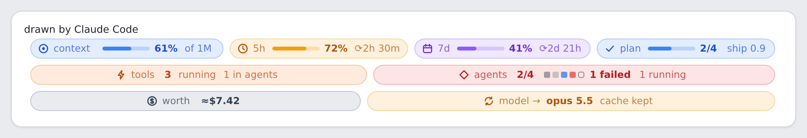
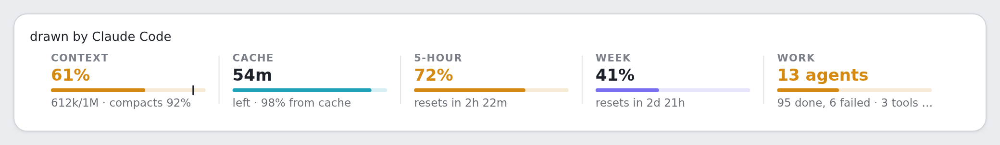
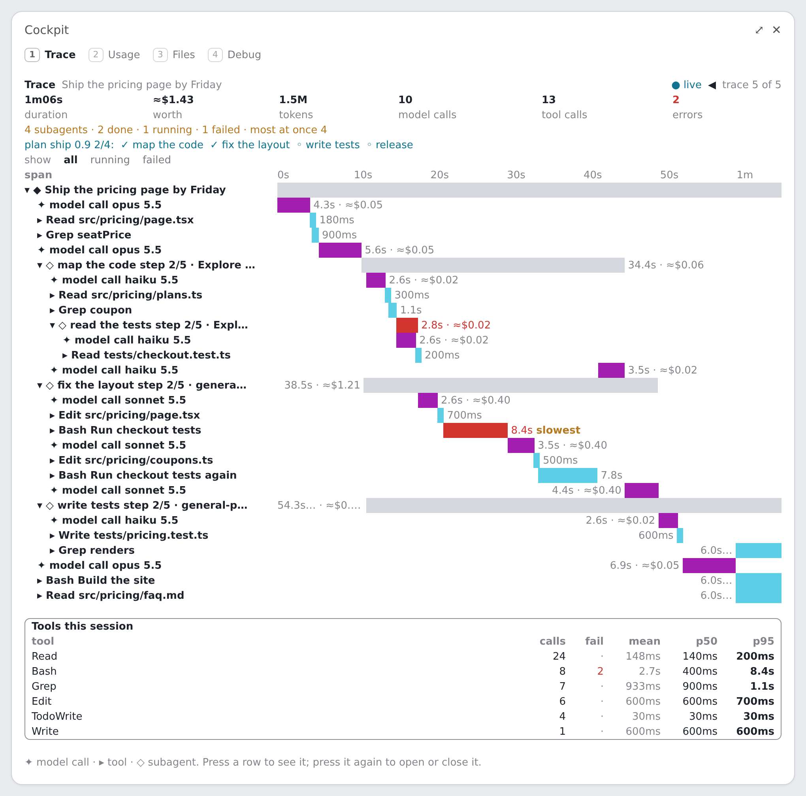
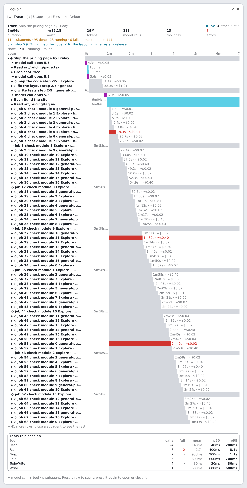
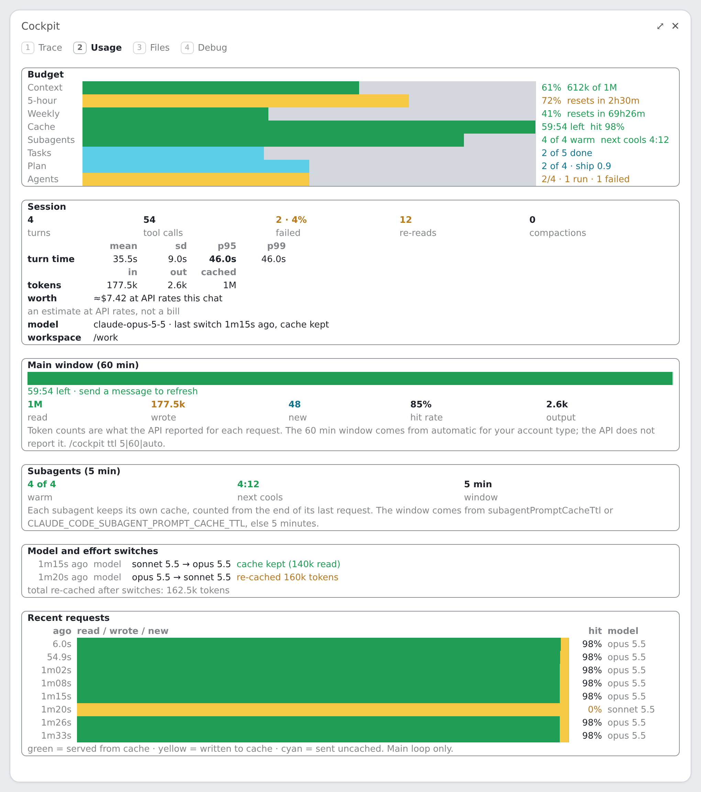
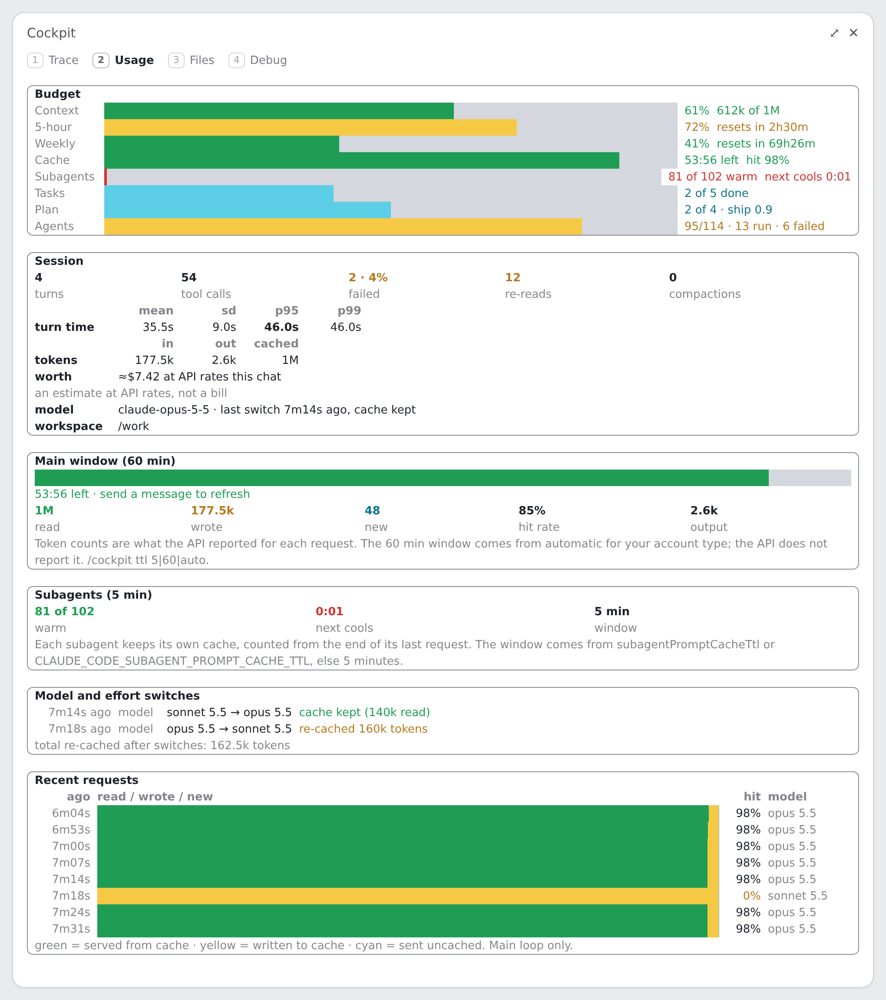
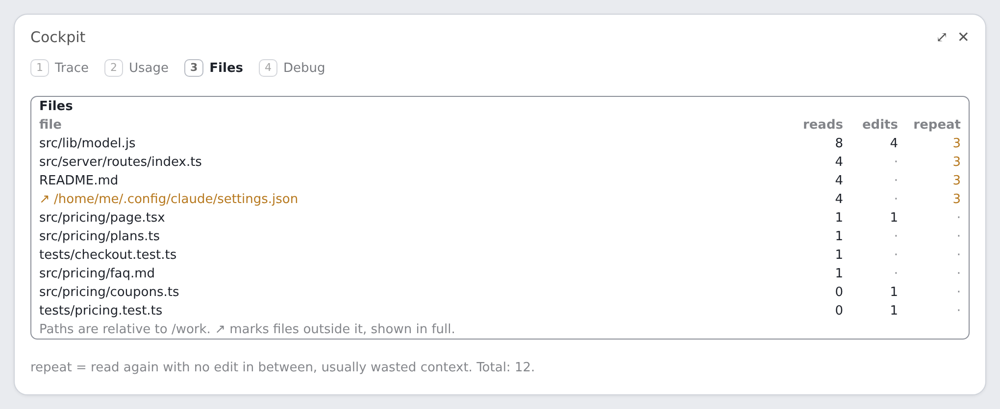
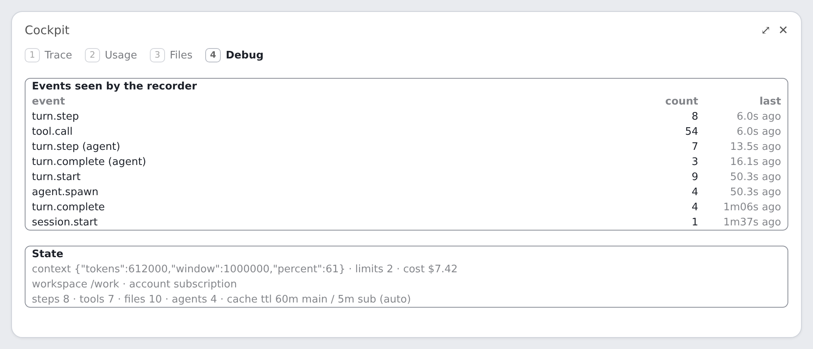

# Gallery

Every view of the cockpit, drawn by `make render` from a seeded session (`.shots/shots.test.ts`). The pane's element tree is laid out as flexbox HTML in headless Chrome (1 column = 8 px), so this shows the layout, not a capture of the Desktop app. Each view is shown 120 columns wide; the 52-column version is linked. `big` is the same session with about 110 more subagents.

## Band above the prompt

The pills: gauges, what runs now, totals. [52 columns](band-52.png).

## Band above the prompt, big crew

The pills: gauges, what runs now, totals. [52 columns](band-big-52.png).

## Trace tab

Where the time went: every model call, tool call and subagent of one prompt on a shared time axis. [52 columns](trace-52.png).

## Trace tab, big crew

Where the time went: every model call, tool call and subagent of one prompt on a shared time axis. [52 columns](trace-big-52.png).

## Usage tab

Context, plan limits, money, session stats, and the prompt cache: window, hit rate, switches, each request. [52 columns](usage-52.png).

## Usage tab, big crew

Context, plan limits, money, session stats, and the prompt cache: window, hit rate, switches, each request. [52 columns](usage-big-52.png).

## Files tab

Reads, edits and re-reads per file. [52 columns](files-52.png).

## Debug tab

Which events the recorder has seen. [52 columns](debug-52.png).

